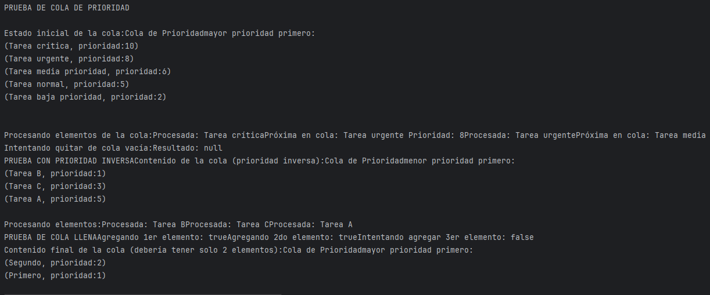
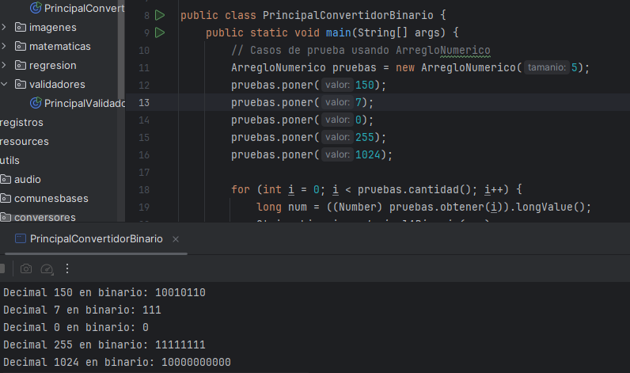
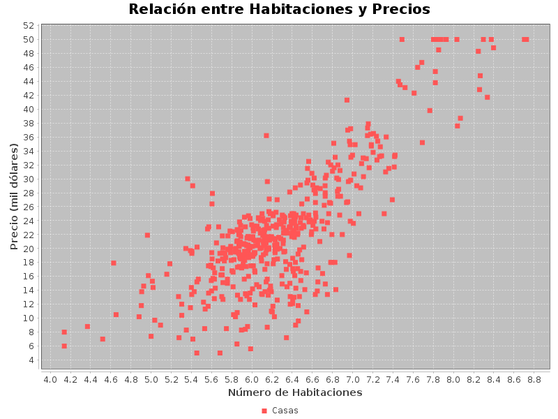

# Data Structures and Algorithms in Java

[](#requirements-and-existing-dependencies)
[](#build-and-verify)
[](https://github.com/DAVEst21/java-data-structures-algorithms/actions/workflows/verification.yml)

An educational Java project that builds data structures by hand and uses them in small applications. Arrays, linked nodes, stacks, queues, matrices, sorting, recursion, and numerical examples show how storage choices affect program behavior.

Developed by **David Ignacio Becerra Morán** for the Data Structures course in the Software Engineering program at Universidad Autónoma de Zacatecas in 2025. Original Spanish identifiers and comments are preserved.

The custom structures and algorithms are academic implementations. Implementing them directly makes index management, links, traversal, capacity, recursion, and composition visible. This repository also retains third-party support code, identified below. The previously unfinished collection methods are now implemented. Verified behavior is separated from remaining mathematical and usage limitations.

## Data structures and algorithms

| Area | Implementations | Current scope |
| --- | --- | --- |
| Arrays | `Arreglo`, `ArregloNumerico`, `ArregloOrdenado` | Fixed-capacity operations, conversions, iterators, bounded fills, and ascending/descending ordered mutations checked. Ordered arrays reject duplicates. |
| Linked lists | `ListaDin`, `Nodo`, `ListaDinClave`, `NodoClaveValor` | Insertion, lookup, removal, traversal, reverse display, conversions beyond ten nodes, and key replacement checked; contracts remain specific to each structure. |
| Stacks | `PilaFija`, `PilaDin` | Both stacks checked for LIFO, empty state, clearing, and display; the dynamic stack retains singly linked tail removal. |
| Queues | `ColaFija`, `ColaDin`, `ColaPrioridad` | Circular FIFO, linked FIFO, clearing, peek, priority direction, and ties checked. Zero-capacity fixed queues reject insertion. |
| Multidimensional arrays | `Arreglo2D`, `Arreglo2DNumerico`, `Arreglo3D` | Bounds, cell access, transpose, and a known matrix product verified. |
| Sorting | `MergeSort` | Recursive split and merge using `Arreglo`; empty, singleton, sorted, reversed, negative, and duplicate inputs checked. |
| Recursion | Binary/hexadecimal conversion, binary-digit validation, `EncriptadorRecursivo` | Known results and boundary cases checked, including examples from the academic report. |
| Applications | Calculator, housing statistics, regression, image processing, sales, farming, race records, airport simulation, KNN, audio | Known-result checks cover selected operations across these applications; larger mathematical and input domains remain bounded. See [verification](docs/VERIFICATION.md) and [limitations](docs/LIMITATIONS.md). |

## Requirements and existing dependencies

- **JDK 21** (`java` and `javac`), matching the existing Maven configuration.
- **Bash** for the provided scripts on Linux/macOS. They also accept `JAVA_HOME` when the JDK is outside `PATH`. Native Windows commands are shown below.
- The existing bundled `libs/jfreechart-demo-1.5.2-jar-with-dependencies.jar`, used only by `GraficadorDispersion`. It already contains JFreeChart 1.5.2, JFreeSVG 3.4, and OrsonPDF 1.9; its usage has not been expanded.
- `utils/audio/wavfile` is bundled source credited to **A. Greensted** in its original header. It supports the audio exercise.

No new application or test dependencies are required. The JDK scripts work without Maven or dependency downloads. Maven is optional; its POM now declares the existing local JAR using `systemPath`. No project license has been added; existing third-party credits are preserved.

## Build and verify

From the repository root:

```bash
java -version
javac -version
bash scripts/build.sh
bash scripts/verify.sh
```

`build.sh` compiles all production Java sources into `target/jdk/classes`. `verify.sh` additionally compiles and runs the small JDK-only checking class. It exits with an error if a check fails; Java assertion flags are unnecessary. The verified run ends with:

```text
Groups passed: 14/14
...
Extended checks passed: 384
```

The original fourteen groups and 384 additional assertions pass. These counts describe explicit checks, not a coverage measurement or a guarantee for all inputs. [Verification details](docs/VERIFICATION.md) distinguish source inspection, compilation, executed examples, checked behavior, and pending work.

GitHub Actions runs the same verification script with JDK 21 on pushes and pull requests to `main`. The Verification badge reflects the latest push run on `main`; the workflow can also be run manually.

To compile directly on Windows with PowerShell and JDK 21:

```powershell
New-Item -ItemType Directory -Force target/jdk/classes | Out-Null
$sources = Get-ChildItem src/main/java -Recurse -Filter *.java |
    ForEach-Object { '"' + $_.FullName.Replace('\', '/') + '"' }
[System.IO.File]::WriteAllLines("$PWD/target/jdk/sources.txt", [string[]]$sources, [System.Text.UTF8Encoding]::new($false))
javac --release 21 -encoding UTF-8 -cp "libs/*" -d target/jdk/classes '@target/jdk/sources.txt'
java -cp "target/jdk/classes;libs/*" principales.utiles.ordenamiento.PrincipalMergeSort
```

The argument file uses quoted paths and UTF-8 without a byte-order mark. The Bash workflow was executed on Linux; these PowerShell instructions have not been executed on Windows.

For an existing Maven setup, `mvn -DskipTests package` uses the same bundled JAR. This build also passed with Maven 3.9.9 and JDK 21. The resulting JAR has no executable main manifest and does not bundle the example resources or JFreeChart. Run examples from the checkout. `mvn test` does not run the checking class; use `scripts/verify.sh`.

## Selected examples and verified results

The runner builds the project and sets its working directory to the repository root, so resource paths resolve consistently:

```bash
bash scripts/run.sh principales.utiles.ordenamiento.PrincipalMergeSort
bash scripts/run.sh principales.colas.PrincipalColaPrioridad
bash scripts/run.sh principales.utiles.conversores.PrincipalConvertidorBinario
bash scripts/run.sh principales.utiles.conversores.PrincipalConvertidorHexadecimal
bash scripts/run.sh principales.recursivas.PrincipalEncriptadorRecursivo
bash scripts/run.sh principales.registros.casas.PrincipalPearsonCasas
bash scripts/run.sh principales.registros.casas.PrincipalGCasas
```

The original programs print Spanish messages. The table describes results observed during the current verification:

| Example | Input | Verified result |
| --- | --- | --- |
| Merge Sort | `5 2 4 6 1 3 2 6` | Numeric order `1 2 2 3 4 5 6 6`; duplicates retained. |
| Priority queue | Priorities `10, 5, 8, 2, 6`, highest first | Removal priorities `10, 8, 6, 5, 2`. Tests also check lowest first and insertion order for tied priorities. |
| Decimal to binary | `150`, `0`, `1024` | `10010110`, `0`, `10000000000`. |
| Decimal to hexadecimal | `65029`, `255`, `0` | `FE05`, `FF`, `0`. |
| Recursive text transformation | Supplied text file; positions `3, 10, 16`, lengths `2, 4, 3` | `Cur(os) de I(rofn)má(cit)a`; decoding restores `Curso de Informática`. This is a reversible exercise, not secure encryption. |
| Housing Pearson correlation | Two supplied files, 498 values each | `0.7964096556804487`. |
| Scatter plot | Same housing data | `target/grafico_casas.png`, 800 × 600 pixels. |

The exact sorted-value line currently contains mixed numeric representations:

```text
1.0 2.0 2.0 3.0 4.0 5.0 6.0 6
```

The merge writes compared values as `double`, while remaining values can retain their original type. This behavior is preserved.

For the image application:

```bash
bash scripts/run.sh principales.utiles.imagenes.PrincipalImagen
```

Choose `1` for grayscale. The included original image is read from `resultados/imagenes/`; the result is written to `target/grises.jpg`. Menu options `10` and `11` select the frame and negative operations. Grayscale was exercised through this menu. Checks using generated images cover color components, flips, 90/180/270-degree rotations, transpose, negative, brightness, frame dimensions, and a 1 × 1 resize. JPEG comparisons allow compression error.

The calculator entry point is `principales.registros.calculadora.PrincipalCalculadora`. A directly checked expression, `(1-2.0)*3/2^(12.0-8)`, produces `-0.1875`. The core methods and the multi-prompt variable-entry flow were checked. The formerly pending `TratamientoExpresiones.convertirInfijaPostfija` now reuses this same stack-based converter. Chained exponentiation is right-associative (`2^3^2` gives `512`); malformed expressions, division by zero, and capacity overflow are rejected. Unary operators remain unsupported.

Generated outputs from the adjusted examples go to ignored `target/`. The original academic output folders remain locally available and are not overwritten by these examples.

## Selected screenshots

**Historical academic capture — priority queue.** Extracted from the original report, PDF page 6, figure 1. It is a historical illustration, not evidence of the current build. The current queue behavior was checked separately.



**Historical academic capture — recursive binary conversion.** Extracted from PDF page 15, figure 15 of the recursion report. The pictured inputs were checked again with the current source.



**Current generated output — housing scatter plot.** Generated from the supplied files by `PrincipalGCasas` during this review, using the existing chart dependency.



Only these two historical captures were selected after visual inspection for personal information. Original documents remain untouched. [Academic report mapping and image provenance](docs/ACADEMIC_NOTES.md) explain the correspondence with the current classes.

## Project structure

```text
src/main/java/
  colecciones/         Custom structures, nodes, and interfaces
  utils/               Sorting, recursion, I/O, numerical and media utilities
  registros/           Application models and operations
  principales/         Individual runnable examples
  resources/           Original text datasets and audio input
src/test/java/
  comprobaciones/      Executable checks using the JDK
libs/                  Existing chart JAR
resultados/imagenes/   Original image input retained for the image example
scripts/               Build, run, and verification scripts
docs/                  Verification, report mapping, limitations, selected images
target/                Ignored compilation products and new example outputs
```

The original resource layout and Maven coordinates are preserved. There is no single application entry point. Each `Principal...` class represents an individual exercise.

## Implementation notes and learning outcomes

- `Arreglo` uses an object array and an upper occupied index. It distinguishes capacity from element count, and shifts elements for removal. Text comparisons use case-insensitive `toString()` equality; numeric storage and signed search results have structure-specific contracts.
- `ListaDin` maintains first/last links and an explicit iterator. Its `quitar(Object)` removes **all** matching values; `quitar(int)` removes one position. `ColaDin` now uses the latter to preserve FIFO duplicates.
- `ArregloOrdenado.buscar` returns **one-based** positive positions when found and negative insertion positions otherwise. Ordinary array indexing remains zero-based. Both directions are checked. Modification can reposition a value to maintain order; duplicate-producing mutations are rejected. The indexed `modificarLista(Arreglo, Arreglo)` overload differs from the old/new-value `modificarLista(ListaDatos, ListaDatos)` overload.
- `ColaPrioridad` appends to a custom array and scans when selecting an element. It is not implemented as a heap.
- Recursive conversion exposes quotient/remainder steps and base cases. Merge Sort exposes splitting, recursive calls, and merging through the custom array API.
- The applications reuse these structures to represent pixels, numeric samples, expression operands, records, and data columns. Their limitations show why individual operation checks matter beyond a successful demonstration.

For fixed-cost element operations, the implementation supports these time bounds; they are derived from loops and storage access, not benchmarks:

| Operation | Time | Reason |
| --- | --- | --- |
| `Arreglo.poner`, `obtener`, parameterless `quitar` | O(1) | One array position and index update/access; no automatic growth. |
| `Arreglo.buscar` / removal by value | O(n) | Linear scan, followed by shifting when removing. String comparison cost is additional. |
| `ListaDin.poner`, `ColaDin.poner` / `quitar` | O(1) | Tail append or first-node removal. |
| `PilaFija` push/pop and circular queue enqueue/dequeue | O(1) | Direct array operations and endpoint updates. |
| `ColaPrioridad` insertion / peek or removal | O(1) / O(n) | Append versus scan and possible shift; printing the full priority order is O(n²). |
| Merge Sort | O(n log n) | Two half-size recursive calls and linear copying/merging per level; O(n) peak auxiliary storage plus O(log n) call depth. |
| Base conversion for positive n | O(log n) | Repeated division by the fixed base; output and recursive depth scale with the digit count. |

## Additional checked applications

```bash
bash scripts/run.sh principales.pilas.PrincipalPilaDin
bash scripts/run.sh principales.colas.PrincipalSimulacionAeropuerto
bash scripts/run.sh principales.registros.carreras.PrincipalCarreras
bash scripts/run.sh principales.registros.granja.PrincipalGranja
bash scripts/run.sh principales.utiles.audio.PrincipalAudio
bash scripts/run.sh principales.clasificadores.knn.PrincipalKnnFrutas
```

- **Dynamic stack:** the original three-value demonstration now removes and displays values correctly. Tail removal traverses the existing singly linked nodes: O(n); push and peek remain O(1).
- **KNN:** still uses `ArregloOrdenado`, now with numeric distance comparison. Equal distances retain distinct training rows, voting ties favor the nearest tied class, and counts use consistent rounded bins. Training rows `2,A` and `10,B`, query `0`, and `k=1` now select `A`. Invalid shapes, nonfinite values, and invalid `k` are rejected. When all information weights are zero, features receive equal weights. These are correctness checks on small examples, not a classification-accuracy study.
- **Race records:** event/runner/year axes now agree between insertion and lookup; the original main reports `90.0` for its aggregate query.
- **Farming and sales:** farming queries were checked with deterministic monthly values, and every farming menu option was executed. Sales checks cover quantities, aligned item/count storage, and known totals; the original demonstrations retain totals `116.0` and `124.0`.
- **Audio:** the main reads the included WAV, reports energy, and writes a time-reversed file to `target/audio_invertido.wav`. Optional arguments specify input/output paths. Speed and silence operations preserve complete channel frames, and WAV frame counts follow the current buffer length. Synthetic mono/stereo and empty-output checks pass. The original commented experiments and plus-sign filter are retained.
- **Airport:** timestamps use `long`, advancing time refreshes queued waiting priorities, and processing respects runway count. This remains a discrete educational simulation.

## Known limitations

- Collection APIs retain their original differences: arrays use signed/index results, lists return values, indexed `poner` replaces in arrays but inserts in lists, and some bulk methods can partially apply. Copying is shallow; some substitution methods share storage/nodes. Do not mutate during iteration or change a backing array directly when relying on ordering.
- Vector dependence tests one supplied coefficient combination; it is not a general linear-dependence solver. A solver would require a separately reviewed algorithm change.
- KNN requires enough configured capacity and valid finite features. Recreate the classifier after reloading or changing its training data. No normalization, missing-feature inference, accuracy, or large-dataset performance claim is made.
- The calculator supports binary operators and numeric operands; unary minus is unsupported. Compact postfix syntax represents single-digit operands; separate larger postfix operands with whitespace.
- Recursive text transformation is a reversible exercise; literal/nested parentheses are not escaped and recursion is not designed for arbitrarily large text.
- Pearson returns `0.0` for empty/zero-variance inputs by the preserved implementation convention, although mathematical correlation is undefined there. Regression retains fixed gradient-descent parameters and cannot guarantee convergence for arbitrary data.
- Audio keeps the report's filter formula and simple frame sampling. PCM writes require finite amplitudes in range; adjust volume if necessary. No signal-quality claim is made. JPEG output is lossy and opaque.
- Resources are filesystem inputs and the packaged JAR is not standalone. Maven's local-JAR warning and native Windows validation remain outstanding.

See [remaining constraints and separate follow-up proposals](docs/LIMITATIONS.md) and [the expanded verification record](docs/VERIFICATION.md).
